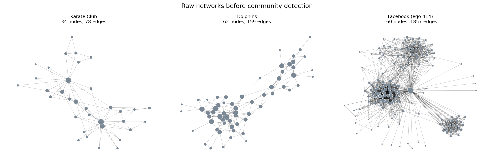
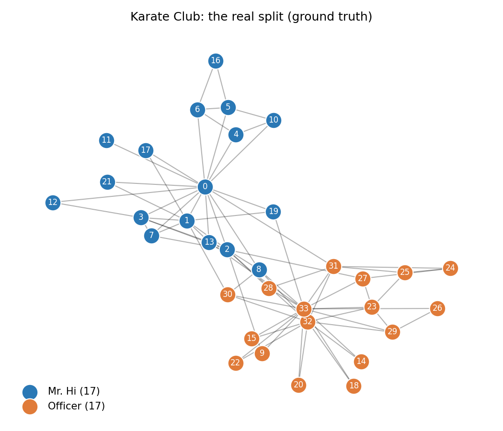

# Community Detection Visualizer

**CSCI 310 Final Project, Fall 2026 · Kyriacos Savva**

📖 **[Full documentation](https://ksavva77.github.io/Community-Detection-Visualizer/)** (built automatically with Sphinx and published to GitHub Pages on every push)

Real-world networks, such as friend groups, animal societies and collaboration graphs, form **communities**: groups of nodes with many links inside the group and few links to the rest of the network. This project finds and draws those communities. It compares two approaches:

| Algorithm | How it works | Implementation |
|---|---|---|
| **Girvan–Newman** | Repeatedly removes the edge with the highest *edge betweenness* (the edge most shortest paths pass through), splitting the graph into communities. It keeps the split with the highest modularity, *Q*. | Written from scratch |
| **Louvain** | Greedily moves nodes between communities to raise modularity, then merges each community into a single node and repeats. | `python-louvain` library, used as a benchmark |

## Datasets

| Dataset | Nodes | Edges | Source |
|---|---:|---:|---|
| Zachary's Karate Club | 34 | 78 | Built into NetworkX (`nx.karate_club_graph()`) |
| Dolphin Social Network | 62 | 159 | [Network Repository](https://networkrepository.com/soc-dolphins.php) |
| Facebook ego network (person 414) | 160 | 1,857 | [Stanford SNAP ego-Facebook](https://snap.stanford.edu/data/ego-Facebook.html) |

The dolphin and Facebook files are downloaded automatically the first time the program runs.

## Getting started

```bash
git clone https://github.com/ksavva77/Community-Detection-Visualizer.git
cd Community-Detection-Visualizer
python3 -m venv .venv
source .venv/bin/activate
pip install -r requirements.txt
python src/community_detection.py
```

## Results so far

### Dataset summary (console output)

```text
           Dataset  Nodes  Edges  Avg Degree  Density  Components  Avg Clustering
       Karate Club     34     78        4.59   0.1390           1          0.5706
          Dolphins     62    159        5.13   0.0841           1          0.2590
Facebook (ego 414)    160   1857       23.21   0.1460           1          0.6858
```

### Raw networks before community detection

Node size shows degree (number of connections).



### Karate Club ground truth

The club really did split in two. This known answer is used to measure how accurate each algorithm's communities are.



## Project status

- [x] **Progress Report 1:** repository, auto-built docs, data loaders, summary table, raw-graph images
- [ ] **Progress Report 2:** Girvan–Newman from scratch, Louvain benchmark, colored community graphs, modularity charts
- [ ] **Final:** runtime comparison, accuracy against ground truth, final README and presentation

## Project layout

```text
├── src/community_detection.py   # all project code (NumPy-style docstrings)
├── docs/                        # Sphinx configuration (conf.py, index.rst)
├── output/                      # generated images
├── data/                        # downloaded datasets (not committed)
├── .github/workflows/           # builds docs and publishes to GitHub Pages
└── requirements.txt
```

## How AI was used

I used **Claude (Anthropic)** as a coding assistant during this project:

- **Proposal review:** Claude checked my proposal against the assignment and pointed out formatting and wording problems, which I fixed.
- **Milestone 1 code:** Claude drafted the data-loading and plotting functions and their docstrings, set up the Sphinx/GitHub Pages workflow, and drafted this README. I reviewed, ran and tested the code.
- **Girvan–Newman (next milestone):** This section will say exactly which parts of the from-scratch implementation were written or helped by AI.

*(This section will be updated as the project continues.)*
