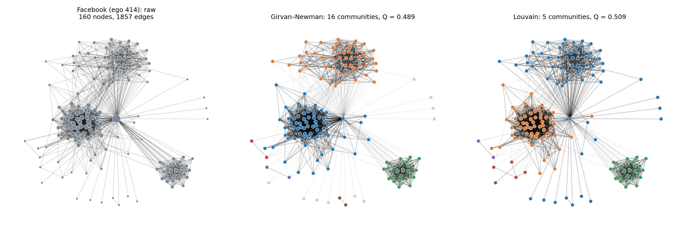
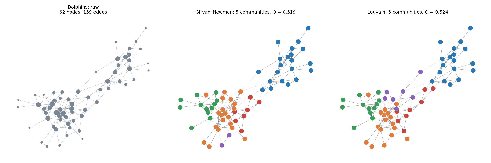
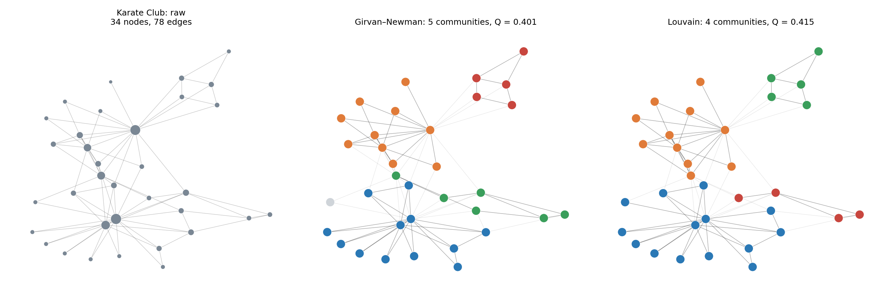
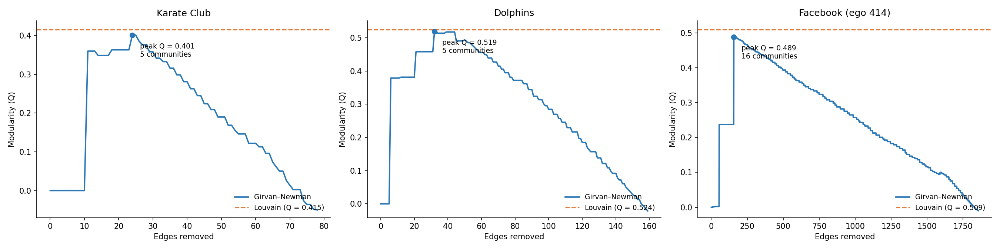
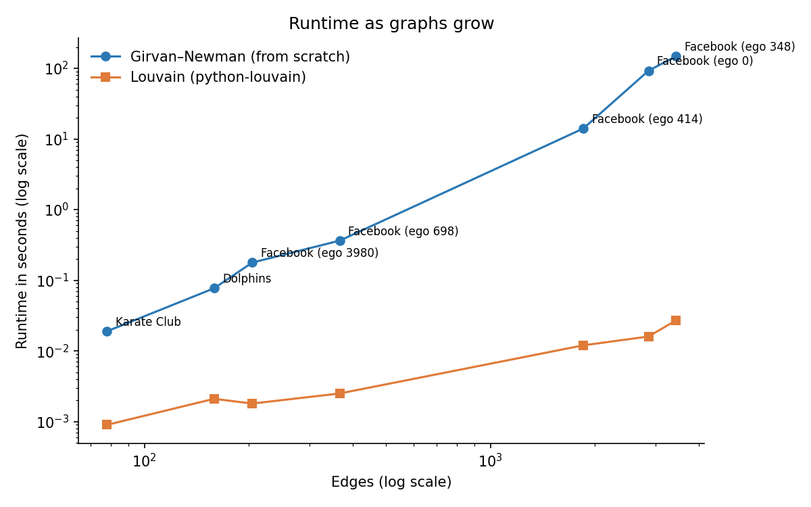
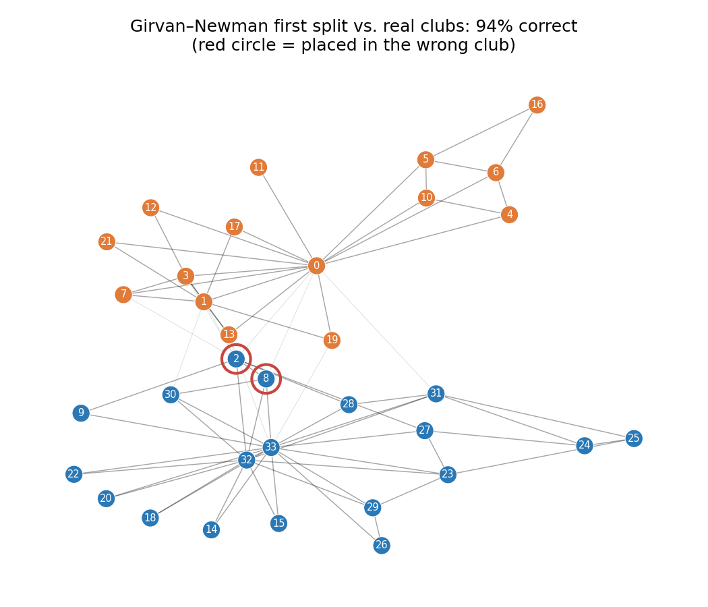

# Community Detection Visualizer

**CSCI 310 Final Project, Fall 2026 · Kyriacos Savva**

[](https://github.com/ksavva77/Community-Detection-Visualizer/actions/workflows/documentation.yml)

📖 **[Full documentation](https://ksavva77.github.io/Community-Detection-Visualizer/)** (built automatically with Sphinx and published to GitHub Pages on every push)

Real-world networks, such as friend groups, animal societies and collaboration graphs, form **communities**: groups of nodes with many links inside the group and few links to the rest of the network. This project finds and draws those communities, and compares two approaches:

| Algorithm | How it works | Implementation |
|---|---|---|
| **Girvan–Newman** | Repeatedly removes the edge with the highest *edge betweenness* (the edge most shortest paths pass through), splitting the graph into communities. It keeps the split with the highest modularity, *Q*. | **Written from scratch** in [`girvan_newman.py`](src/girvan_newman.py): BFS, connected components, Brandes' edge betweenness and modularity |
| **Louvain** | Greedily moves nodes between communities to raise modularity, then merges each community into a single node and repeats. | `python-louvain` library, used as a benchmark |

## Key results

| Dataset | Nodes | Edges | GN communities | GN Q | GN time | Louvain communities | Louvain Q | Louvain time |
|---|---:|---:|---:|---:|---:|---:|---:|---:|
| Karate Club | 34 | 78 | 5 | 0.401 | 0.02 s | 4 | 0.415 | 0.001 s |
| Dolphins | 62 | 159 | 5 | 0.519 | 0.08 s | 5 | 0.524 | 0.002 s |
| Facebook (ego 414) | 160 | 1,857 | 16 | 0.489 | 14.0 s | 5 | 0.509 | 0.012 s |

- **Quality:** Louvain found a slightly higher modularity on every dataset, but the two methods are close (within 0.02 on Karate and Dolphins).
- **Speed:** Girvan–Newman is about 20× slower on the Karate Club and more than 5,000× slower on the largest Facebook network, and the gap grows with graph size (see the runtime chart).
- **Accuracy:** On the Karate Club, Girvan–Newman's first split matches the real club split for **94%** of members (32 of 34). Only nodes 2 and 8 are misplaced, and both have strong ties to both sides. Louvain scores **97%**.

### Community drawings (raw graph | Girvan–Newman | Louvain)





### Modularity as Girvan–Newman removes edges

Each curve rises as the graph splits into real communities, peaks, and then falls as communities are broken apart. The dashed line is Louvain's result.



### Runtime as graphs grow

Girvan–Newman recomputes edge betweenness (O(nm)) after each of the m edge removals, so it grows much faster than Louvain. Both axes use a log scale.



### Karate Club accuracy



## Datasets

| Dataset | Nodes | Edges | Source |
|---|---:|---:|---|
| Zachary's Karate Club | 34 | 78 | Built into NetworkX (`nx.karate_club_graph()`) |
| Dolphin Social Network | 62 | 159 | [Network Repository](https://networkrepository.com/soc-dolphins.php) |
| Facebook ego networks | 60–348 | 205–3,441 | [Stanford SNAP ego-Facebook](https://snap.stanford.edu/data/ego-Facebook.html) |

The dolphin and Facebook files are downloaded automatically the first time the program runs.

## Getting started

```bash
git clone https://github.com/ksavva77/Community-Detection-Visualizer.git
cd Community-Detection-Visualizer
python3 -m venv .venv
source .venv/bin/activate
pip install -r requirements.txt
python src/main.py        # about 4 minutes; images are saved in output/
```

Run the tests (they check the from-scratch code against NetworkX):

```bash
pip install pytest
python -m pytest tests
```

## How the from-scratch Girvan–Newman works

1. **Edge betweenness (Brandes' algorithm):** run a BFS from every node, count the shortest paths to each other node, then walk back from the farthest nodes and give each edge its share of those paths.
2. **Remove** the edge with the highest score. Ties are broken by edge key, so every run gives the same result.
3. **Recompute only what changed:** betweenness is recomputed only for the component the removed edge belonged to, because shortest paths in other components can't change.
4. **Track modularity:** every time the graph splits, compute *Q = Σ [L_c/m − (d_c/2m)²]* for the new partition.
5. **Return** the partition with the highest *Q*.

The tests confirm that the betweenness scores, the modularity values and the first four splits are identical to NetworkX's.

## Project layout

```text
├── src/
│   ├── girvan_newman.py        # from-scratch algorithm (BFS, Brandes, modularity)
│   ├── community_detection.py  # dataset loaders, summary table, raw-graph plots
│   ├── comparison.py           # Louvain, accuracy, charts, scaling test
│   └── main.py                 # runs everything
├── tests/                      # pytest checks against NetworkX
├── docs/                       # Sphinx configuration (conf.py, index.rst)
├── output/                     # generated images
├── .github/workflows/          # builds docs and publishes to GitHub Pages
└── requirements.txt
```

## How AI was used

I used **Claude (Anthropic)** as a coding assistant throughout this project:

- **Proposal:** Claude checked my proposal against the assignment and pointed out formatting and wording problems.
- **Code:** Claude wrote the code in this repository with me, including the from-scratch Girvan–Newman implementation, the data loaders, the plots and the tests, along with their NumPy-style docstrings. I reviewed the code, ran it, and checked the results against NetworkX using the tests.
- **Setup and writing:** Claude set up the Sphinx/GitHub Pages workflow and drafted this README and the project report.
